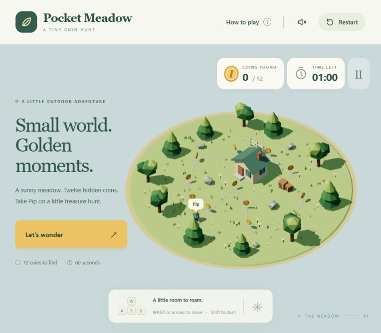

# Pocket Meadow validation

Validated on November 3, 2026.

## Assets

- Original kit built in Blender 5.2.2 LTS through MCP for Blender.
- Ten asset roots; 1,264 source triangles; one shared vertex-colour material; no image textures.
- `meadow-kit.glb`: 147,368 bytes. Every audited mesh has zero non-manifold edges and applied rotation/scale.
- The browser loaded all ten roots and the explorer's four named limb pivots.
- The camera uses one fixed gameplay distance; the small assets do not require runtime LOD switching.
- Separate circle/box colliders own movement constraints. Decorative foliage and flowers are not solid gameplay obstacles.

## Functional checks

Eight Node tests passed: ready state, normalized movement, sprint collision without tunnelling, island boundary, single coin pickup and completion, pause/reset, time expiry, and reachable coin placements.

In the real browser, a keyboard-only lap collected all twelve coins and displayed the win dialog in 17.9 seconds. The personal best survived reloading. Restart restored zero collected coins and a sixty-second timer. Escape and the pause button stopped gameplay. The instruction dialog paused and resumed the round. The audio toggle enabled without browser errors; audio is synthesized locally.

The on-screen joystick moved the player in a 390 × 844 viewport using a pointer drag; the touch pause button worked. The layout was also inspected at 1440 × 900 and the default 764-pixel-wide preview. No horizontal overflow was observed in the phone layout. Browser console warnings/errors: none during the tested interactions.

The timer uses actual active-frame elapsed time; visual effects use a bounded animation delta. Visibility/focus changes pause an active round. Reduced-motion settings stop decorative coin motion and collection bursts; the first-frame camera matrices are explicitly updated for the player label.

## Skill use and scope

3dviz-pro-max guidance read: object reasoning/craft, Blender/Three.js handoff, lighting direction and scale, and template/capture contracts. Retrieved and adapted `knowledge.style-low-poly` revision 2: sparse silhouettes, vertex colours, a small matte palette, and a single directional key plus hemisphere fill. The custom palette, orthographic camera, metre-scale light framing, original geometry, and game state were authored specifically for this game. No finished catalog kit, third-party model, paid generation, or image texture was used.

Arjun's director, low-poly, optimization, and export skills guided the asset pipeline. The editable Blender source, generator and audit are included. This is a single-level prototype with browser-local best times, not a multiplayer or server-ranked game. Phone testing used a resized browser and pointer input, not a physical phone.

